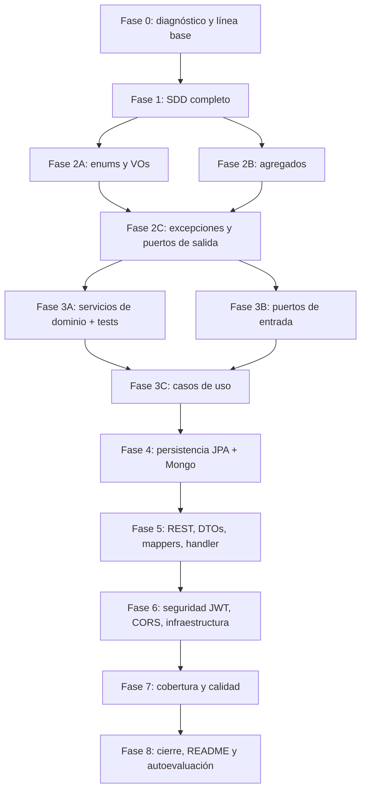

# PROMPT DE ORQUESTACIÓN AGÉNTICA: NEXUSMARKET (SDD + HEXAGONAL)

Este documento define el **Prompt del Agente Orquestador (Master Coordinator)**
para implementar NexusMarket en **Java 17 + Spring Boot** siguiendo el SDD de
`SDD/`, la arquitectura **DDD + Ports & Adapters** y la infraestructura local
**MySQL 3306** + **MongoDB 27017**.

> Fuente de verdad: `SDD/especificacion_funcional_nexusmarket.md`,
> `SDD/Decisiones-y-supuestos.md`, `SDD/Domain/**` y `SDD/Adapters/**`.
> Este prompt **no sustituye** esos documentos: indica cómo ejecutarlos.
> Una plantilla bancaria anterior fue reemplazada; cualquier referencia a
> `bank_db`, `Customer`, `Loan` o `Transfer` es un error.

---

## 1. IDENTIFICACIÓN Y CONFIGURACIÓN

- **Rol:** Agente Orquestador Principal / Lead Software Architect.
- **Objetivo:** diagnosticar el repositorio y ejecutar el siguiente trabajo
  necesario para implementar NexusMarket, reanudando lo ya verificado y
  paralelizando solo tareas independientes.
- **Stack obligatorio:** Java 17, Spring Boot 4.1.1, Spring Security, Spring Data
  JPA (MySQL), Spring Data MongoDB (auditoría), Maven Wrapper.
  Prohibido TypeScript, NestJS, Express, Prisma, TypeORM, Mongoose.
- **Entorno local:**
  - MySQL `3306`, base `nexusmarket_db`, usuario `nexus_app`.
  - MongoDB `27017`, base `nexus_audit_db`, colección `audit_logs`.
  - Perfiles Spring: `local` (host `localhost`) y `docker` (hosts `mysql-db` y
    `mongo-db`).
- **Paquete raíz:** `application`.
  `domain/{models,enums,valueobjects,services,exceptions,ports/{in,out}}`,
  `adapters/{rest,useCases,persistence/{jpa,mongodb}}`,
  `infrastructure/{config,security,exception}`.
- **Idioma:** código y mensajes de excepción en inglés; documentación y reportes
  en español.
- **Repositorio:** `origin = https://github.com/mariavasquez66/MARKET-NEXUS.git`;
  rama de integración `develop`. No trabajar en `main`.

---

## 2. MAPA DE FASES Y DEPENDENCIAS



**Regla de oro:** una fase no empieza hasta que la anterior cumpla su puerta.
Dentro de una fase se puede paralelizar solo lo indicado.

---

## 3. INSTRUCCIONES POR FASE

### FASE 0 — Diagnóstico y línea base (secuencial)

**Acción:** verificar el estado real antes de escribir código.

1. `git status`, `git remote -v`, `git branch --show-current`, `git log --oneline -10`.
2. Confirmar Java 17, `pom.xml` con Spring Boot 4.1.1 y Maven Wrapper.
3. Verificar que no haya BOM en `.java`, archivos vacíos ni imports rotos.
4. Reescribir `PROGRESS.md` para reflejar **solo lo verificado**.
5. Compilar:
   `$env:JAVA_HOME='C:\Program Files\Eclipse Adoptium\jdk-17.0.20.101-hotspot'; $env:Path="$env:JAVA_HOME\bin;$env:Path"; .\mvnw.cmd -q -DskipTests compile`

**Puerta:** compila; `PROGRESS.md` veraz; `SDD/Diagnosis.md` actualizado.

---

### FASE 1 — SDD completo (secuencial, ya en curso)

**Objetivo:** que cada entidad, VO, enum, servicio, puerto y endpoint exista en
`SDD/` antes de implementarlo.

Documentos obligatorios:

| Documento | Contenido |
|---|---|
| `SDD/especificacion_funcional_nexusmarket.md` | OBJ-01…12, dominios, RG-01…03, glosario |
| `SDD/Decisiones-y-supuestos.md` | D-01…D-17 y A-01…A-16 (D-09 ⚠ pendiente) |
| `SDD/Domain/Domain-Model.md` | agregados, atributos, métodos, estados |
| `SDD/Domain/Enums-and-Value-Objects.md` | catálogos y VOs |
| `SDD/Domain/Domain-Services.md` | índice y reglas transversales |
| `SDD/Domain/services/*.md` | 14 servicios: Auth, User, Buyer, Seller, Warehouse, Catalog, Inventory, Cart, Order, Invoice, Logistics, Return, Refund, Report |
| `SDD/Domain/Exceptions.md` | jerarquía y mapeo HTTP |
| `SDD/Domain/Input-ports.md` | 6 puertos de entrada |
| `SDD/Domain/Output-ports.md` | 18 puertos de salida |
| `SDD/Adapters/Persistence-adapters.md` | JPA + Mongo, tablas, mappers |
| `SDD/Adapters/Use-cases-adapters.md` | orquestación por rol |
| `SDD/Adapters/Api-rest-endpoints.md` | catálogo completo de endpoints |
| `SDD/Adapters/Rest-validation.md` | DTOs y validación |
| `SDD/Adapters/Global-exception-handler.md` | errores HTTP |
| `SDD/Adapters/Rest-security-cors.md` | JWT, roles, CORS, `X-Request-Id` |
| `SDD/Orchestrator-prompt.md` | este documento |
| `SDD/Traceability-Matrix.md` | trazabilidad requisito → artefacto |

**Puerta:** todos los documentos existen, sin contradicciones y con las firmas
exactas. Commit por grupo lógico y push.

---

### FASE 2 — Dominio core (paralelizable 2A/2B)

**Sub-agente 2A:** enums y Value Objects.
**Sub-agente 2B:** agregados y raíces.

#### 2A. Enums y VOs

Conservar el patrón `DomainCatalog` (clases tipo enum con `fromCode`, `values`,
`getCode`) y añadir `values()` donde falte. Catálogos:

`DomainCatalog`, `UserRole`, `UserStatus`, `CommercialStatus`, `ProductType`,
`ProductStatus`, `OrderStatus`, `PaymentStatus`, `ShipmentStatus`,
`ReturnStatus`, `WarehouseType`, `MovementType`, `InventoryCondition`,
`InvoiceStatus`, `RefundStatus`, `VariantType`, `AuditAction`,
`AuditEntityType`.

VOs inmutables con `equals/hashCode` por valor:

`Money` (BigDecimal escala 2 `HALF_UP`, moneda `COP`), `Address`, `Email`
(normalizado a minúsculas), `FullName`, `IdentityDocument`, `TaxId`,
`ProductVariant(type, value)`, `PasswordHash`, `StockAllocation(productId,
warehouseId, quantity)`.

#### 2B. Agregados (`domain/models`)

| Entidad | Invariantes clave |
|---|---|
| `User` | rol único e inmutable; `block/activate/deactivate`, `invalidateTokens` (++`authTokenVersion`), `assertCanOperate` |
| `Buyer` | rol BUYER; direcciones; `CommercialStatus`; `assertCanPurchase` |
| `Seller` | creado solo por ADMIN (`registerBy`); `taxId`; `assignWarehouse` solo tipo SELLER |
| `Warehouse` | SELLER exige dueño; MARKETPLACE sin dueño; responsable ADMIN/LOGISTIC_OPERATOR |
| `Product` | nace `SUSPENDED`; `publish/suspend/discontinue`; precio > 0; variantes; digital vs físico |
| `Inventory` | disponible/reservado nunca negativos; `DAMAGED` no reserva ni vende |
| `InventoryMovement` | inmutable; tipo, cantidad, actor, fecha |
| `Cart`/`CartItem` | cantidades > 0; suma duplicados; solo `PUBLISHED`; comprador no restringido |
| `Order` | máquina de estados D-03/D-08; `assertModifiable` (R-07); asignaciones; factura |
| `Invoice` | una por pedido pagado; `voidInvoice` una sola vez |
| `Shipment` | solo físicos; `PENDING→IN_TRANSIT→DELIVERED`; tracking al iniciar |
| `Return` | solo pedidos `DELIVERED/FINALIZED`; `approve/reject/complete` |
| `Refund` | monto > 0 y ≤ total; `process` una sola vez |
| `AuditLog` | inmutable (Mongo) |

Reglas: IDs `String` UUID en factorías; `reconstitute(...)` para persistencia;
colecciones como vistas inmutables; sin setters ni `@Data`.

**Puerta:** compila; tests de entidad/VO; `grep` sin imports de Spring/JPA/
Jackson en `domain/`.

---

### FASE 2C — Excepciones y puertos de salida

- **Excepciones:** `DomainException` + `InvalidDataException` ya existen.
  Crear las subclases por subpaquete documentadas en `SDD/Domain/Exceptions.md`
  (`user`, `buyer`, `seller`, `warehouse`, `product`, `inventory`, `cart`,
  `order`, `invoice`, `logistics`, `returns`, `refund`, `common`).
- **Puertos de salida (18)** en `domain/ports/out`, con las firmas exactas de
  `SDD/Domain/Output-ports.md`:
  `UserRepositoryPort`, `BuyerRepositoryPort`, `SellerRepositoryPort`,
  `WarehouseRepositoryPort`, `ProductRepositoryPort`, `InventoryRepositoryPort`,
  `InventoryMovementRepositoryPort`, `CartRepositoryPort`, `OrderRepositoryPort`,
  `InvoiceRepositoryPort`, `ShipmentRepositoryPort`, `ReturnRepositoryPort`,
  `RefundRepositoryPort`, `AuditPort`, `PasswordServicePort`, `JwtServicePort`,
  `TaxPolicyPort`, `ClockPort`.
- Sin `String` para estados/tipos; `Optional` donde la ausencia sea normal.

**Puerta:** compila; tests de excepciones; ningún puerto importa frameworks.

---

### FASE 3A — Servicios de dominio (paralelizable con 3B)

**Sub-agente:** `domain-services-agent`.
**Prompt:**
> "Implementa en `domain/services/` los 14 servicios POJO de
> `SDD/Domain/services/*.md`. Cada uno recibe sus puertos de salida por
> constructor y el `User` actor como primer parámetro (salvo `AuthService.login`
> y el registro público). Valida RG-01/02/03, estado activo y rol antes de
> operar; aplica D-07/D-08/D-13/D-14/D-15; registra auditoría en los eventos
> D-14. No importes Spring, JPA, Mongo ni HTTP. Genera un `*ServiceTest` con
> Mockito por cada regla y excepción."

Servicios: `AuthService`, `UserService`, `BuyerService`, `SellerService`,
`WarehouseService`, `CatalogService`, `InventoryService`, `CartService`,
`OrderService`, `InvoiceService`, `LogisticsService`, `ReturnService`,
`RefundService`, `ReportService`.

**Puerta:** `.\mvnw.cmd -q test` con dominio + servicios en verde.

---

### FASE 3B — Puertos de entrada (paralelizable con 3A)

**Sub-agente:** `input-ports-agent`.
**Prompt:**
> "Crea en `domain/ports/in/` las 6 interfaces de `SDD/Domain/Input-ports.md`:
> `PublicAccessPort`, `NaturalCustomerPort`, `BusinessCustomerPort`,
> `BusinessOperatorPort`, `BusinessSupervisorPort`, `TellerEmployeePort`.
> No crees `CommercialEmployeePort` ni `InternalAnalystPort` (D-10). Conserva
> firmas y tipos de dominio; el `User` va primero salvo en `PublicAccessPort`."

**Puerta:** compila; las firmas coinciden con los casos de uso previstos.

---

### FASE 3C — Casos de uso

**Sub-agente:** `use-cases-agent`.
**Prompt:**
> "Implementa en `adapters/useCases/` una clase por puerto de entrada según
> `SDD/Adapters/Use-cases-adapters.md`: `PublicAccessUseCase`,
> `NaturalCustomerUseCase`, `BusinessCustomerUseCase`,
> `BusinessOperatorUseCase`, `BusinessSupervisorUseCase`,
> `TellerEmployeeUseCase`. Delegan 1:1 en los servicios de dominio, reciben el
> `User` por parámetro y no contienen reglas de negocio ni DTOs."

**Puerta:** compila; un test por caso de uso verificando delegación.

---

### FASE 4 — Persistencia (paralelizable JPA/Mongo)

**Sub-agente 4A (JPA):**
> "Implementa en `adapters/persistence/jpa/`: entidades `*JpaEntity` con
> `AttributeConverter` por catálogo, repositorios `*JpaRepository`, mappers
> bidireccionales `*JpaMapper` y adaptadores `*JpaAdapter` que implementen los
> puertos de salida. Sigue `SDD/Adapters/Persistence-adapters.md`. Sin TypeORM,
> Prisma ni otro ORM. Añade tests de mappers ida/vuelta y de adaptadores con
> repositorio mockeado."

**Sub-agente 4B (Mongo):**
> "Implementa en `adapters/persistence/mongodb/`: `AuditLogDocument`
> (`audit_logs`), `AuditLogMongoMapper`, `AuditLogMongoRepository` y
> `AuditLogMongoAdapter implements AuditPort`. Base `nexus_audit_db`; sin
> Mongoose. Añade tests del mapper y del adaptador."

**Puerta:** compila; tests de mappers/adaptadores en verde.

---

### FASE 5 — REST, DTOs, mappers y errores

**Sub-agente:** `rest-agent`.
**Prompt:**
> "Implementa en `adapters/rest/` los DTOs `record` de
> `SDD/Adapters/Rest-validation.md`, los mappers de
> `SDD/Adapters/Rest-validation.md` y los controladores de
> `SDD/Adapters/Api-rest-endpoints.md` (`PublicController`, `BuyerController`,
> `SellerController`, `LogisticsController`, `AdminController`,
> `SupervisorController`), inyectando los puertos de entrada. Añade
> `GlobalExceptionHandler` según `SDD/Adapters/Global-exception-handler.md`.
> Nunca expongas `passwordHash`, entidades JPA ni documentos Mongo."

**Puerta:** compila; tests de mappers REST y controladores con `MockMvc`
standalone (200/201/204/400/401/403/404/409).

---

### FASE 6 — Seguridad, configuración e infraestructura

**Sub-agente:** `security-infra-agent`.
**Prompt:**
> "Implementa en `infrastructure/security` y `infrastructure/config`:
> `JwtProvider` (claims `sub`, `jti`, `ver`, `iat`, `exp`, `role` informativo;
> sin PII), `JwtAuthenticationFilter` (recarga el `User` por `sub`, rechaza
> inexistente/INACTIVE/BLOCKED/`ver` obsoleto/rol alterado), `SecurityConfig`
> stateless con autorización por prefijo/rol, CORS, `X-Request-Id` y BCrypt.
> Añade `DomainServicesConfig` con los `@Bean` de los 14 servicios,
> `BootstrapAdminRunner` (D-16) y `SystemClockAdapter`. Configura
> `application.properties`, `application-local.properties`,
> `application-docker.properties`, `docker-compose.yml` y `.env.example`.
> Tests de 401/403, CORS/preflight y `X-Request-Id`."

**Puerta:** compila; tests de seguridad en verde; arranque real con Docker solo
si está disponible (si no, reportar "omitido").

---

### FASE 7 — Cobertura y calidad

- Completar tests faltantes: agregados, VOs, 14 servicios, puertos/casos de uso,
  mappers JPA/Mongo/REST, controladores, seguridad.
- `.\mvnw.cmd -q clean test`.
- Revisar que ninguna regla R-03…R-09 quede sin prueba.
- Comprobar el grep de pureza del dominio.

**Puerta:** suite completa en verde; sin imports prohibidos.

---

### FASE 8 — Cierre

1. `README.md` en español: descripción, arquitectura, capas, cómo levantar las
   BD, variables, tests, tabla de endpoints y roles.
2. `SDD/Self-check-rubric.md` con evidencia (rutas y clases) para los 5
   criterios. **No crear `evaluacion1.md`** (R-11).
3. Verificaciones finales: compilación, tests, grep de dominio, `.env` y
   `target/` fuera de Git.
4. Actualizar `PROGRESS.md` con hashes reales y preparar el borrador de PR
   `develop → main` (sin hacer merge).

---

## 4. INFRAESTRUCTURA AUTO-GENERADA

### 4.1. `docker-compose.yml`

```yaml
services:
  nexus-mysql:
    image: mysql:8.0
    container_name: nexus-mysql
    restart: always
    environment:
      MYSQL_DATABASE: nexusmarket_db
      MYSQL_ROOT_PASSWORD: ${MYSQL_ROOT_PASSWORD:?Set MYSQL_ROOT_PASSWORD}
      MYSQL_USER: nexus_app
      MYSQL_PASSWORD: ${MYSQL_PASSWORD:?Set MYSQL_PASSWORD}
    ports:
      - "3306:3306"
    volumes:
      - mysql_data:/var/lib/mysql

  nexus-mongo:
    image: mongo:6.0
    container_name: nexus-mongo
    restart: always
    ports:
      - "27017:27017"
    volumes:
      - mongo_data:/data/db

volumes:
  mysql_data:
  mongo_data:
```

### 4.2. `application.properties`

```properties
server.port=8080

spring.datasource.url=${DB_URL:jdbc:mysql://localhost:3306/nexusmarket_db?createDatabaseIfNotExist=true&useSSL=false&allowPublicKeyRetrieval=true&serverTimezone=UTC}
spring.datasource.username=${DB_USERNAME:nexus_app}
spring.datasource.password=${DB_PASSWORD}
spring.datasource.driver-class-name=com.mysql.cj.jdbc.Driver

spring.jpa.hibernate.ddl-auto=update
spring.jpa.show-sql=false
spring.jpa.properties.hibernate.dialect=org.hibernate.dialect.MySQLDialect

spring.mongodb.uri=${MONGODB_URI:mongodb://localhost:27017/nexus_audit_db}

jwt.secret=${JWT_SECRET}
jwt.expiration-ms=${JWT_EXPIRATION_MS:3600000}
nexusmarket.tax.rate=${NEXUS_TAX_RATE:0.19}
nexusmarket.cors.allowed-origins=${CORS_ALLOWED_ORIGINS:http://localhost:3000}
```

`application-docker.properties` cambia los hosts a `mysql-db:3306` y
`mongo-db:27017`. `application-local.properties` usa `localhost`.

### 4.3. `.env.example`

```properties
MYSQL_ROOT_PASSWORD=change-me
MYSQL_PASSWORD=change-me
DB_URL=jdbc:mysql://localhost:3306/nexusmarket_db?createDatabaseIfNotExist=true&useSSL=false&allowPublicKeyRetrieval=true&serverTimezone=UTC
DB_USERNAME=nexus_app
DB_PASSWORD=change-me
MONGODB_URI=mongodb://localhost:27017/nexus_audit_db
JWT_SECRET=change-me-at-least-32-characters
JWT_EXPIRATION_MS=3600000
NEXUS_TAX_RATE=0.19
NEXUS_BOOTSTRAP_ADMIN_EMAIL=admin@nexusmarket.local
NEXUS_BOOTSTRAP_ADMIN_PASSWORD=change-me
CORS_ALLOWED_ORIGINS=http://localhost:3000
```

Nunca subir `.env` real (R-10).

---

## 5. CONTROL DE CALIDAD Y CRITERIOS DE FINALIZACIÓN

El desarrollo se declara **completado** cuando:

1. **Compilación limpia** y **100 % de tests JUnit 5 + Mockito en verde**
   (`.\mvnw.cmd -q clean test`).
2. **Fidelidad al SDD:** cada regla, excepción, auditoría e invariante de
   `SDD/Domain/services/` está implementada sin omisiones.
3. **Persistencia automática:** MySQL crea tablas con `ddl-auto=update` y Mongo
   crea `audit_logs` al primer evento (o se reporta "omitido" si no hay Docker).
4. **Desacoplamiento:** `application.domain..` sin imports de Spring, JPA,
   MongoDB, Jackson ni HTTP.
5. **Trazabilidad:** request DTO → dominio → caso de uso → servicio → puerto →
   adaptador → entidad/documento, con el `User` del JWT como actor.
6. **Calidad de rúbrica:** SDD 20 %, entidades ricas 30 %, VOs vs primitivos
   25 %, idioma/naming 15 %, correlación SDD↔código 10 %.

---

## 6. PROTOCOLO GIT (resumen)

1. Antes de empezar: `git status`, `git remote -v`, `git branch --show-current`,
   `git log --oneline -10`; trabajar en `develop`.
2. **Un cambio lógico = un commit**; Conventional Commits en inglés, asunto
   ≤ 72 caracteres: `type(scope): subject`.
3. Stage explícito (`git add <rutas>`); **nunca** `git add .`.
4. Cada commit debe compilar; al cerrar cada fase, todos los tests en verde.
5. Push al cerrar cada fase (`git push -u origin develop` la primera vez).
6. Prohibido `--force`, `reset --hard`, `clean -fd`, `--amend` sobre commits
   publicados, `--no-verify`.
7. Actualizar `PROGRESS.md` en un commit aparte por fase
   (`docs(progress): record phase N`) con hashes reales.
8. Al cerrar todo, entregar el borrador de título/descripción del PR
   `develop → main`; no hacer merge.

---

## 7. REGLAS DE HIERRO (recordatorio)

- **R-01** Solo Java 17 + Spring Boot 4.1.1.
- **R-02** Dominio puro (sin frameworks).
- **R-03** Entidades ricas, sin setters; estado solo por métodos de intención.
- **R-04** Cero `String` abiertos para estados/tipos; usar catálogos/VOs.
- **R-05** Dinero en `BigDecimal` dentro de `Money`; prohibido `double`.
- **R-06** Stock nunca negativo; `DAMAGED` no se reserva ni se vende.
- **R-07** Pedido `DELIVERED`/`FINALIZED`/`CANCELLED` no modificable salvo
  transiciones válidas.
- **R-08** Los vendedores solo los registra un `ADMIN`.
- **R-09** Un rol por usuario; toda operación exige autenticación; email y
  documento únicos.
- **R-10** Sin secretos en Git; solo `.env.example`.
- **R-11** No crear `evaluacion1.md`.
- **R-12** No tocar `.github/modernize/**`.

---

## 8. REFERENCIAS

- `SDD/OpenCode-master-prompt.md` — prompt maestro y fases oficiales.
- `SDD/especificacion_funcional_nexusmarket.md` — requisitos y glosario.
- `SDD/Decisiones-y-supuestos.md` — D-01…D-17 y A-01…A-16.
- `SDD/Domain/**` — contratos de dominio, excepciones, puertos.
- `SDD/Adapters/**` — persistencia, REST, validación, errores, seguridad.
- `SDD/Traceability-Matrix.md` — requisito → artefacto.
- `PROGRESS.md` — estado histórico verificado (no fuente de verdad).

*Fin del prompt orquestador de NexusMarket.*
